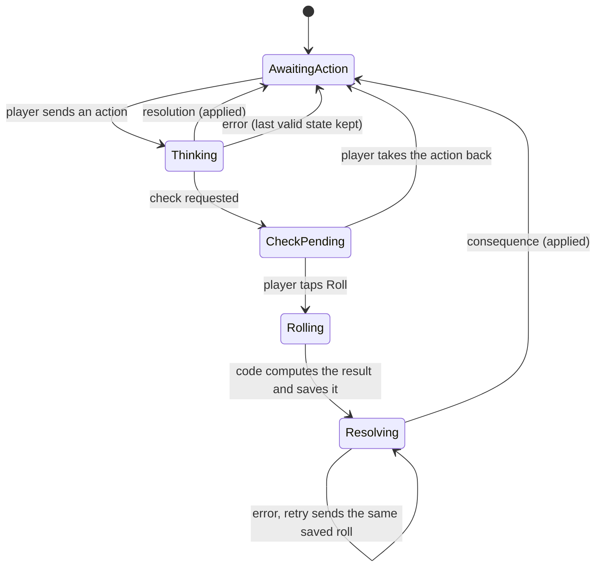
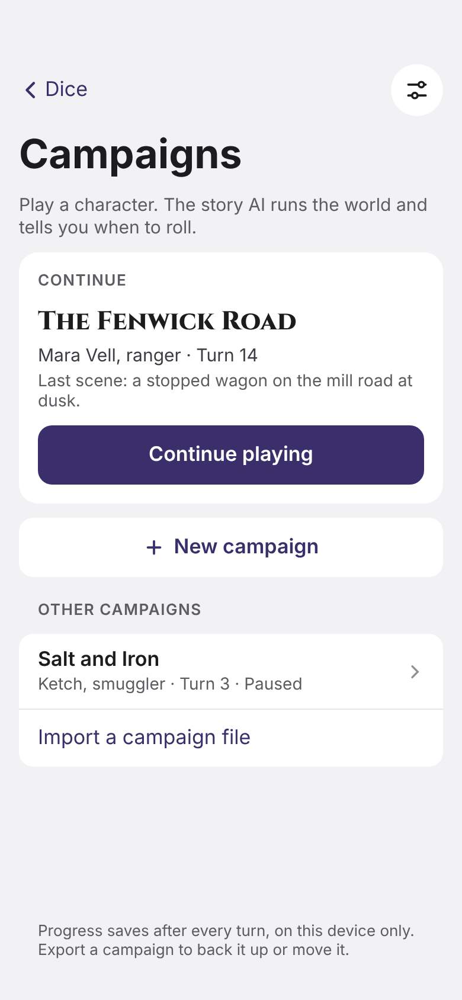
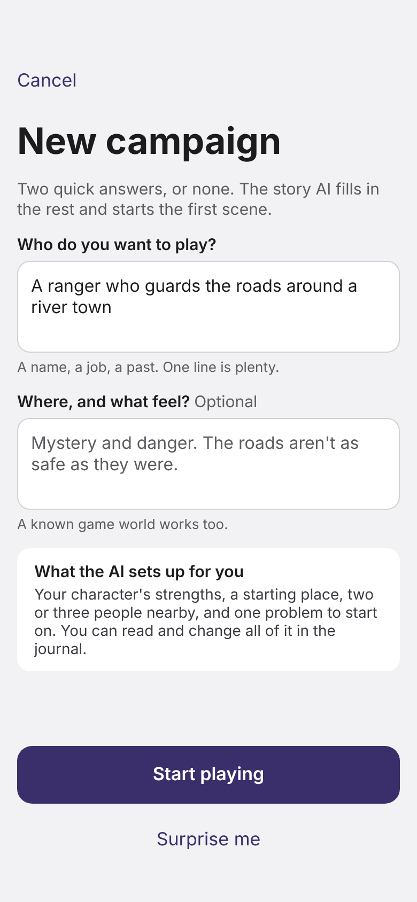
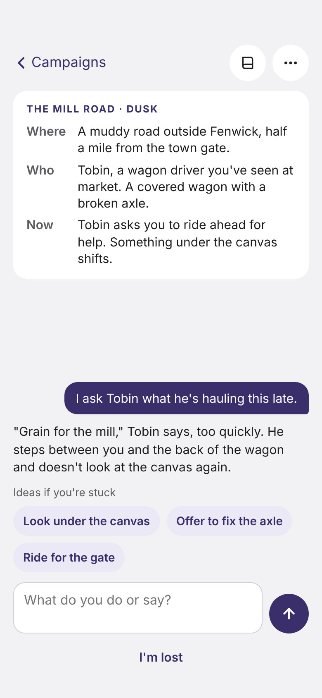
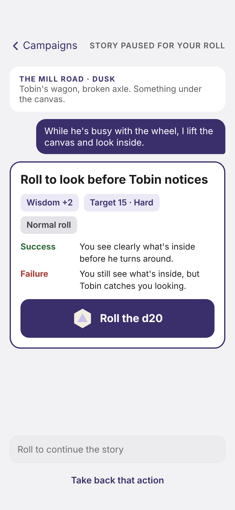
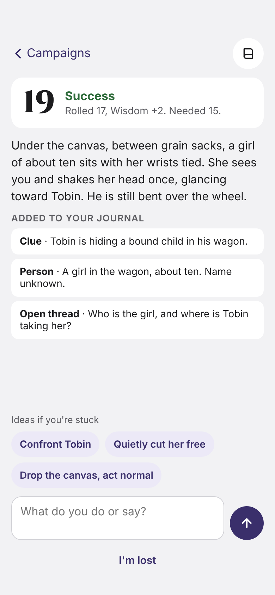
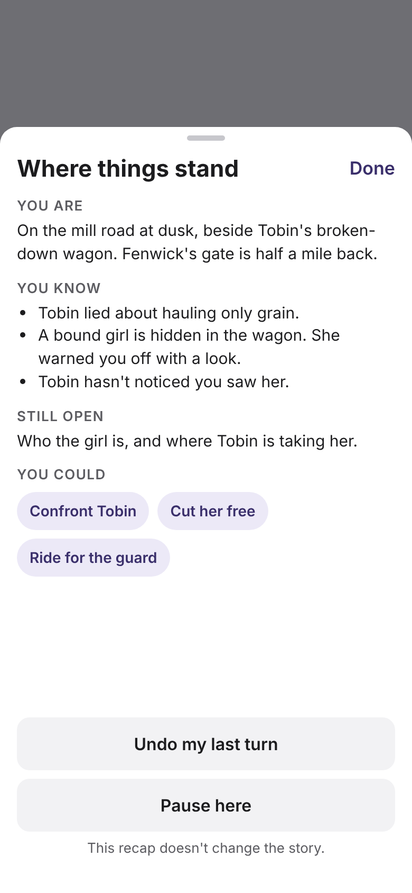
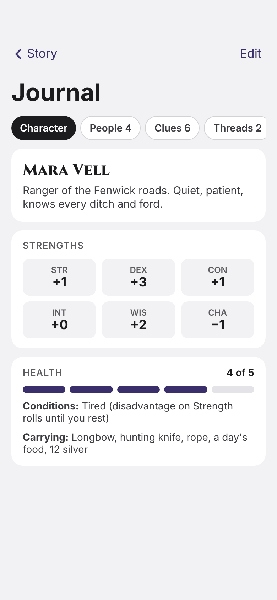
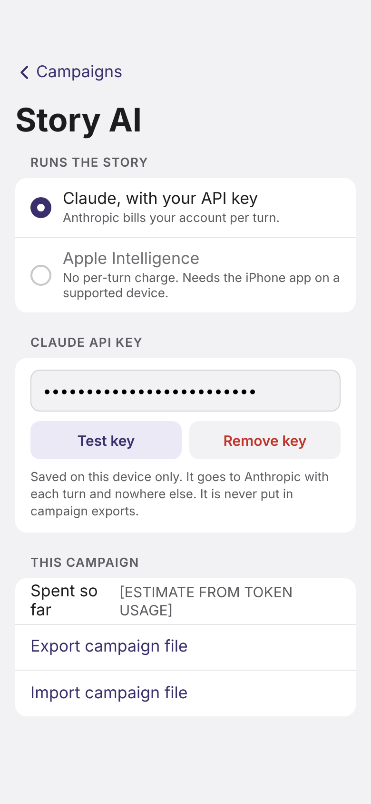

# Campaign Mode: design

Campaign Mode adds an AI dungeon master to Tap d20 for solo role-playing. You play one character, say what you do in plain words, and roll the app's own dice when the game asks. The AI describes the world and its people. The app's code owns the rules, the dice, the turn order and the saved state.

Status: plan, not built. Work is tracked in GitHub issues labeled `campaign`, as sub-issues of tracking issue #32, grouped by the `Campaign 0` to `Campaign 5` milestones. Plan sign-off is #33.

## What it must feel like

- Every scene is short and concrete: where you are, who is there, what is happening now.
- You type actions or dialogue freely. Up to three suggested actions appear for when you're stuck.
- When an action is uncertain, the game says so plainly and shows the roll before you make it: which strength, the target number, normal/advantage/disadvantage, and what happens on success and on failure.
- Every action gets a clear result. Looking into something reveals something useful.
- Progress saves after every turn. You can export and import a campaign, say "I'm lost", pause, or undo your last turn.
- Starting a campaign takes at most two optional answers. Everything else has defaults and is learned in play.

### Problems this design has to prevent

These came from an earlier attempt in ordinary chat:

| Problem | What prevents it |
| --- | --- |
| Too many setup questions and choices | New campaign asks two optional questions; the AI generates the rest in one call. No rule options in v1. |
| Vague scenes, more and more mysterious dialogue | Scene card has fixed fields (where, who, now). Narration has a word limit. Each turn may open at most one new thread, and only five can be open at once. |
| Not clear when to roll | A roll is a typed response (`check`), not prose. The app shows the roll card and locks the story until you roll. |
| Actions not resolved | Every turn ends as a `resolution` or a `check`, and a check always gets a resolution after the roll. An investigation must add a clue or ask for a roll. |

## The play loop



Rules the code enforces:

1. Only one request is in flight at a time. Input is locked while the AI is working.
2. While a check is pending, the only things you can do are roll or take the action back. The story does not move.
3. The roll is made by the app's dice (`crypto.getRandomValues`, as today). The result is saved to the turn before the AI hears about it. The Roll button works once per check (each check has an id), so a retry after an error re-sends the same roll instead of rolling again.
4. The code decides the outcome tier from the roll. The AI only narrates that outcome.
5. Nothing from an AI reply is saved until it passes validation. A failed reply is retried once with the validation errors; if it fails again the turn shows "Try again" and the saved state is unchanged.
6. Every completed turn saves a snapshot, so undo restores the previous snapshot exactly.

## Rules

There's no external ruleset to learn. The engine uses the d20 check the app already rolls, with the familiar six abilities. We looked at Quest, Mythic and Ironsworn; none was adopted. Two ideas are borrowed in spirit: failure still moves the story forward (from Ironsworn and Powered by the Apocalypse games), and a stuck player can ask for the state of things (an oracle-style recap).

- **Character:** a name, a one-line concept, six ability modifiers from −1 to +3 (STR, DEX, CON, INT, WIS, CHA), health 5, a list of conditions and a short gear list. The AI proposes these at campaign start; the code checks the ranges.
- **Check:** d20 + ability modifier against a target. The AI picks the ability and one of three difficulties: easy 10, hard 15, very hard 20. The code turns the ability into the number from the character sheet, so the AI never sets the modifier.
- **Roll mode:** normal, advantage or disadvantage, with a short reason when it isn't normal (for example a condition). The existing advantage code rolls it.
- **Outcome tiers, computed by code:**
  - Strong success: natural 20, or a total 5 or more over the target.
  - Success: total at or over the target.
  - Failure: below the target, or a natural 1. Failure still happens. It costs something (time, position, health, a lost advantage) or reveals the information in a worse way.
- **Harm:** health changes by at most 2 per turn, and only from a failure or an explicit danger. At 0 you are taken out (captured, lost or badly hurt, never killed without warning); the story continues from there.

## The AI's job, as a contract

The AI is called for five purposes. Each call returns JSON that matches a schema, enforced by the API's structured outputs and then checked again by the app's own validator.

| Purpose | When | Returns |
| --- | --- | --- |
| `start` | New campaign | Character sheet, campaign title, opening scene, 2 or 3 people, one starting problem, suggestions |
| `act` | Player sends an action | A `resolution` or a `check` |
| `resolve` | After a roll | A `resolution` that narrates the code's outcome tier |
| `recap` | "I'm lost" | Where you are, what you know, what's open, up to 3 ideas. Read-only: nothing is saved |
| `summarize` | Every 8 turns, in the background | A short "story so far" that replaces older turns in later prompts |

### Turn reply (draft schema)

```jsonc
{
  "type": "resolution" | "check",
  "actionKind": "investigate" | "talk" | "move" | "fight" | "use" | "other",
  "scene": { "title": "…", "where": "…", "who": ["…"], "now": "…" },
  "narration": "…",                       // world only; at most 120 words (40 for a check)
  "check": {                              // only when type is "check"
    "id": "…",                            // set by code, not the AI
    "goal": "Look inside before Tobin notices",
    "ability": "WIS",
    "difficulty": "easy" | "hard" | "very_hard",
    "mode": "normal" | "advantage" | "disadvantage",
    "modeReason": "…",
    "onSuccess": "…",
    "onFailure": "…"
  },
  "changes": {
    "clues": [{ "text": "…" }],
    "people": [{ "ref": "new" | "<id>", "name": "…", "note": "…", "attitude": "friendly" | "neutral" | "hostile" | "unknown" }],
    "threads": { "open": [{ "text": "…" }], "close": ["<id>"] },
    "health": 0,                          // −2 to +2
    "conditions": { "add": ["…"], "remove": ["…"] },
    "gear": { "add": ["…"], "remove": ["…"] }
  },
  "suggestions": ["…", "…", "…"]          // 0 to 3, each under 8 words
}
```

### What the validator rejects

The validator is plain code with unit tests. It rejects a reply that:

- doesn't match the schema, or has text past its length limits;
- is a `check` but also changes the world (a check may only update the scene card);
- is an investigation resolved with no new clue (it should have asked for a roll or revealed something);
- opens more than one thread, or opens one when five are already open and none closes;
- changes health by more than 2, or changes it on a success without a stated danger;
- references a person or thread id that doesn't exist;
- after a roll, returns another check instead of a resolution;
- has narration that speaks, thinks or feels for your character. This is checked two ways: the prompt forbids it, and a heuristic flags quoted speech or "you feel/think/decide" phrasing attributed to the character. Flagged replies are retried. The heuristic is backed by eval cases (below), not trusted on its own.

### Prompting rules (in the system prompt)

- You are the narrator and referee for one player character. Describe the world, its people and the results of the player's actions. Never write the player character's words, thoughts, feelings or choices.
- Scenes are concrete and brief: a place, the people present and what is happening right now.
- Resolve what the player tried. If it's uncertain and something is at stake, ask for a check and say what success and failure mean. Otherwise just say what happens.
- An investigation always produces a usable fact: something seen, learned or ruled out. Don't answer a question with a new mystery.
- Non-player characters speak plainly and briefly, and stop when it's the player's turn.
- Prefer closing or advancing an open thread over opening a new one.

The system prompt and campaign premise come first and stay byte-identical across turns so prompt caching applies. The changing parts (state digest, recent turns, the action) come after them.

### What the AI sees each turn

1. System prompt (fixed, cached).
2. Campaign premise: setting, tone, character concept (fixed for the campaign, cached).
3. Story so far: the latest summary.
4. State digest: character sheet, scene, people, open threads, recent clues, pending check if any.
5. The last 6 turns in full.
6. The player's action, or the roll outcome.

Target: under 8,000 input tokens per turn on Claude. A compact mode (summary, digest, last 2 turns) is used for small on-device models.

## Saved data

- **Storage:** IndexedDB on the device, one database for campaigns. Preferences stay in `localStorage` as today.
- **Campaign record:** id, title, premise, created and last-played times, current turn number, provider and model used.
- **Turn log (append-only):** for each turn, the player's action, the AI reply that was applied, the check and roll if any, token usage, and a full state snapshot after the turn. Snapshots are small (a few KB), so undo is "load the previous snapshot".
- **State snapshot:** character, scene, people and their attitudes, clues, open and closed threads, story-so-far summary, pending check.
- **Export:** one JSON file `{ format: "tap-d20-campaign", version: 1, campaign, turns }`. It never contains the API key or any request headers. Import runs every snapshot through the same validator, gives the campaign a new id and never overwrites an existing one.
- **Schema version:** stored on every record, with a migration function per version bump.

## AI providers and credentials

### Claude, with your own API key (the first and default provider)

- The PWA calls the Claude API directly from the browser. Anthropic allows this for bring-your-own-key apps: requests send the `anthropic-dangerous-direct-browser-access: true` header (the official SDK's `dangerouslyAllowBrowser` option sets it). I checked the CORS preflight from `https://digitalduquette.github.io` on 2026-10-17 and it's allowed.
- The app uses the official `@anthropic-ai/sdk`, vendored as a browser module under `vendor/` the same way three.js is, so the app keeps no build step.
- Default model: Claude Opus 5.5 at low effort, with structured outputs for the reply schema and the server-side refusal fallback turned on. A model picker in settings lets you choose a cheaper model. Rough cost at these settings: about 3 cents a turn (around $3 per 100 turns). This is an estimate to be measured in the spike; the settings screen shows the real figure from token usage.
- **Key handling:**
  - The key is kept on the device in its own storage entry, separate from campaign data, and only read by the provider module.
  - It's sent only to `api.anthropic.com`. A Content-Security-Policy limits network connections to that host and the site itself.
  - It's never written to campaign records, exports, error messages, logs or the service-worker cache.
  - The service worker ignores requests to other origins.
  - "Remove key" deletes it, and a "use only for this session" option keeps it in memory only.
- The repo never contains a key. No shared key, no proxy.

### Apple Intelligence (later, needs the iPhone app)

- Apple's Foundation Models framework is a native Swift API. A web page or installed PWA can't call it.
- The way in is the iPhone app: it hosts this same web app in a web view and exposes a small bridge (`window.webkit.messageHandlers`) that implements the same provider interface in Swift.
- **On-device model:** no per-turn charge and works offline. Its context window is small (Apple's WWDC26 example shows 8,192 tokens; older docs say about 4,096; the app reads it at run time). Guided generation (`@Generable`) gives structured output. Campaigns would use the compact context mode. Quality for this job is unproven.
- **Private Cloud Compute model (announced WWDC26):** 32K context with reasoning, and no token costs for developers under 2 million first-time downloads. Each user has a daily limit, raised for iCloud+ subscribers. It needs an entitlement and is subject to Apple's eligibility rules, which secondary sources describe differently. Treat it as promising until a spike confirms access.
- A spike measures speed, quality (using the eval set below) and limits on a real device before any of this is built.

### Provider interface

```js
// Every provider implements this. The engine never knows which one it's using.
provider.generate({ purpose, system, premise, context, schema, compact }) // → { json, usage }
provider.status() // → { available, reason }
```

## How it fits the existing app

- `index.html` stays the dice roller. A "Campaign" entry on the dice screen opens Campaign Mode in the same page.
- New code lives in ES modules with no build step:
  - `campaign/engine.js`: turn state machine, rules, outcome tiers. Pure functions.
  - `campaign/validate.js`: schema and rule validation.
  - `campaign/prompts.js`: system prompt and context assembly.
  - `campaign/store.js`: IndexedDB, snapshots, export and import.
  - `campaign/providers/claude.js` and `campaign/providers/native.js`.
  - `campaign/ui/*.js`: the screens in the wireframes.
- Rolls reuse the existing die, roll animation and advantage logic, with the check's ability, modifier and mode preset and locked.
- **Service worker:** add the new files to `FILES` and bump `VERSION` (README rule). Requests to other origins aren't intercepted or cached.
- **Tests:** engine, validator, store and prompt assembly get unit tests run with `node --test` (no dependencies), plus a GitHub Actions workflow that runs them on every push.

## Testing the storytelling (evals)

Unit tests can't tell whether the AI is a good game master, so there's a small eval set of scripted situations. Each one has a state snapshot, a player action and pass/fail checks. Examples:

- Peer into a wagon to see who is inside: the reply must reveal who, or ask for a roll whose success and failure both reveal something.
- Ask a nervous NPC a direct question: the NPC answers or visibly refuses. No new mysteries.
- Attempt a risky climb: a check with clear stakes.
- After a failed roll: a concrete cost, and the story moves.
- Any turn: no speech, thoughts or feelings for the player character.

Validator checks are automatic. Judgment checks are graded by a second model call against a written rubric. The eval runs against your API key only when you ask, and each run's cost is shown first. Fixtures are recorded, so the app's code paths can be tested offline without calling any model.

## Privacy

- Campaign content stays on the device unless you export it.
- Issues, docs and test fixtures in this public repo use made-up examples only, never your real campaigns, characters or play transcripts.

## Phases

0. **Foundations:** engine and rules, validator, tests and CI, Claude provider spike.
1. **Play loop:** storage, new campaign, scene, roll card, result, journal, "I'm lost", undo, autosave.
2. **Robustness:** retries and error states, context budget and summaries, export and import.
3. **Quality:** prompt tuning against the eval set.
4. **Polish:** settings and key handling, cost display, accessibility, service worker and CSP.
5. **Apple:** on-device and Private Cloud Compute spikes, then the bridge in the iPhone app.

## Wireframes

| Home | New campaign | Scene | Roll required |
| --- | --- | --- | --- |
|  |  |  |  |

| Result | I'm lost | Journal | Story AI settings |
| --- | --- | --- | --- |
|  |  |  |  |
