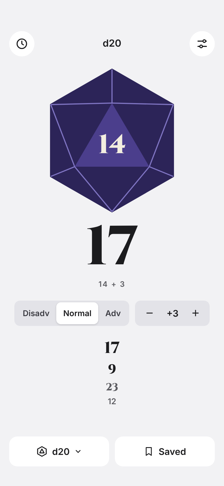
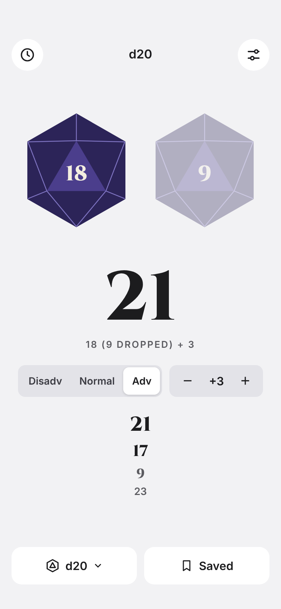
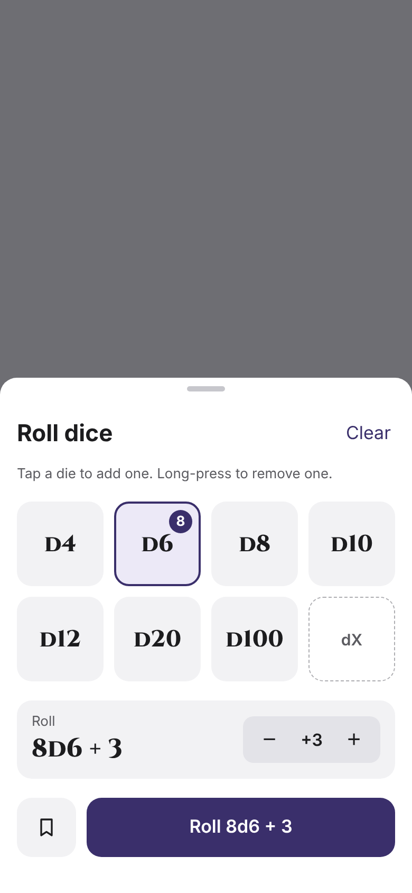
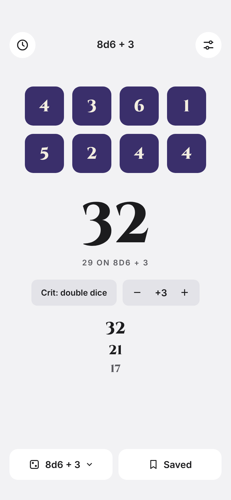
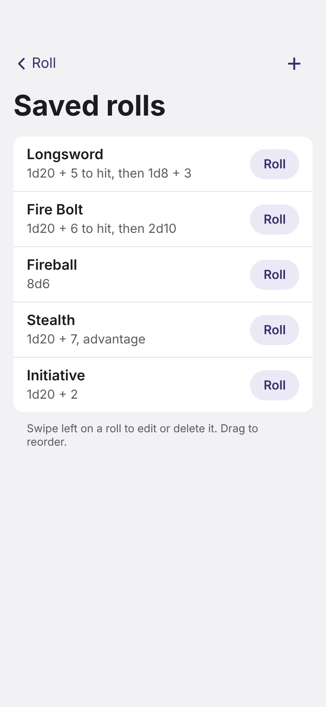
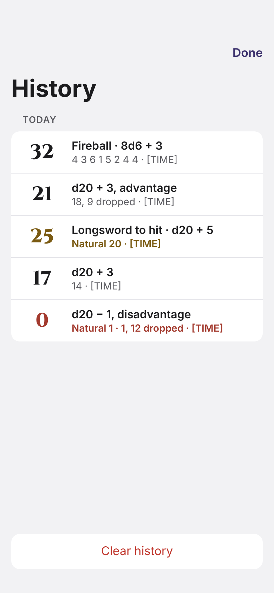
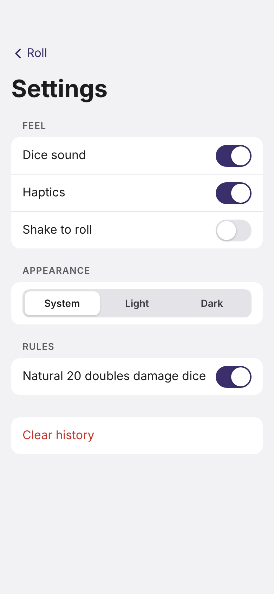

# Tap d20 for iPhone

Plan for a native SwiftUI version of the web app. The work is tracked as issues labeled `ios` (#1 to #31), grouped by the `iOS 1` to `iOS 8` milestones. These wireframes show what each screen should look like.

Open decision before #5 starts: Campaign Mode's Apple Intelligence provider (#57) needs the iPhone app to host the web app in a web view. That means choosing between this full SwiftUI rewrite, a web-view shell for everything, or SwiftUI dice with a web-view campaign screen. Most of #6 to #28 change if the answer is a web-view shell.

| Roll | Advantage | Dice picker | Damage roll |
| --- | --- | --- | --- |
|  |  |  |  |

| Saved rolls | History | Settings |
| --- | --- | --- |
|  |  |  |

## Phases

1. Setup: Mac and Xcode, developer account, project, icon and fonts.
2. Core roll: dice engine, 3D d20, roll animation, roll screen, haptics, accessibility.
3. Advantage and modifier.
4. More dice: d4 to d100, dice picker, multi-dice results, crit damage.
5. Saved rolls and history.
6. Settings, sound and shake to roll.
7. Home screen widget, Siri and Shortcuts.
8. TestFlight, App Store listing and review.
